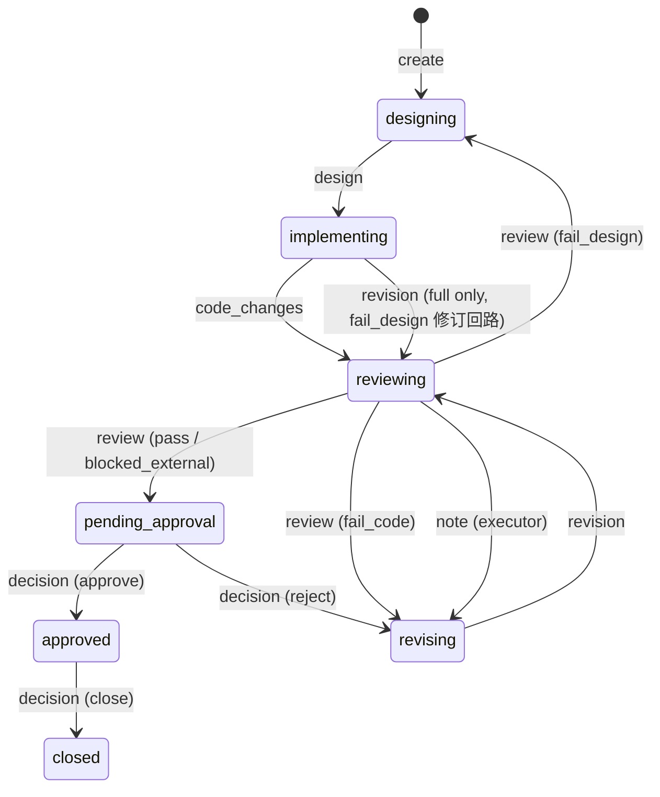

# TUT 系统设计文档

## 1. 概述

TUT（Take Ur Turn）让多个 coding agent 围绕同一任务协作。Context Hub 保存追加式过程记录，纯函数从记录序列派生任务状态，Notifier 观察状态并通知或启动下一角色，人负责关键审批。

本文是宿主无关的系统根文档；设计文档反映当前行为，决策理由与验证经过保存在 Context Hub。

- [上下文内容与管理](context-design.md)。
- [Herdr 宿主实现](herdr-host.md)。
- [Standalone 宿主实现](standalone-host.md)。

## 2. 整体架构

| 模块 | 职责 |
|---|---|
| Context Hub | 本地 MCP / HTTP 服务、追加式任务记忆、状态投影 |
| Coding agent | 加载角色 skill，读取上下文、工作并发布交付 |
| Notifier | 轮询状态、消费辅助证据、通知、执行消费侧启动检查 |
| Agent Host | 提供可插拔信号源与启动器，见第 7 章 |
| Channel | 将 Notifier 生成的文案投递给人 |

```text
Agent ── MCP 读写 ──► Context Hub ──► 本地 JSON
  ▲                        │
  │ 启动                   │ GET /state、任务日志
Agent Host ── 运行证据 ──► Notifier ──► Channel ──► 人
```

Hub 只对记忆负责：写入不因流程、角色或时序被拒，基本合法性仍校验。流程规则约束消费侧，写入自由不构成绕过人工审批的许可。所有存储读写经 Store / HTTP 接口进行。

任务流程以派生状态为准，终端状态、进程退出和日志输出仅为辅助证据。依赖事实无法确认时明确失败，只有明确规定的兼容入口允许可见降级；不猜身份、不静默代入、不盲目重试。

多个 Hub 对相同的记录序列和任务元数据按相同规则派生时，得到相同状态视图。当前 Store 通过本地 JSON 读写记录，记录如何在机器之间共享不改变该纯函数一致性。

## 3. 任务状态

任务状态是记录序列的派生视图。`derive(taskId, records, flow?)` 按版本顺序折叠全量记录，输出 status、waiting_for、warnings；缓存可由同一输入重放恢复。

### 3.1 派生规则

flow 在 create 时冻结，缺省为 full。full 路径如下，三种 flow 的差异见转换表：



| 记录 | full（上图） | direct（repo 已有设计） | solo（小改动免审） |
|------|------------|----------------------|-------------------|
| create（空序列） | → designing | → **implementing** | → **implementing** |
| design | designing → implementing | **implementing → implementing**（参考记录，不转态）；其余态表外 | 同 direct（参考记录，不转态） |
| code_changes | implementing → reviewing | 同 full | implementing → **pending_approval** |
| review(pass / blocked_external / fail_code) | reviewing → pending_approval（pass、blocked_external 同目标）/ revising（fail_code） | 同 full | **表外 → pending_approval + needs_attention**（免审流程里发 review 由人裁决） |
| review(fail_design) | reviewing → designing | **表外 → pending_approval + needs_attention**（direct 无 designing 态；设计前提被推翻由人裁决） | 表外 → pending_approval + needs_attention |
| review（四档合法 verdict 的表外 catch-all） | 非 closed 状态无对应转换行时 → pending_approval + needs_attention，保留 OUT_OF_TABLE(version) | 同 full | 同 full |
| note（reviewing 态，role=executor，非 ack） | reviewing → revising | 同 full | 行不可达（solo 无 reviewing 态；其余 note 照旧不转态） |
| revision | revising → reviewing；implementing → reviewing（典型场景是 fail_design 修订回路：设计打回重设计落地后，executor 按信封纪律（修订轮以 revision 交付）以 revision 交付修订；派生无历史，implementing 收 revision 一律入行，不以回路前史为门） | revising → reviewing；implementing 下**表外**（fail_design 回路不存在） | **表外**（revising 不可达，无 review 修订回路） |
| decision(reject) | pending_approval → revising | 同 full | pending_approval → **implementing**（打回重做） |
| 其余（approve/close/note/ack/异常） | 现行语义（note 默认不转态，唯一例外见 note 行） | 同 full | 同 full |

`decision(close)` 在任意状态进入 closed；closed 是吸收态。重复 close 幂等，note 在 closed 下仍可追加而不转态，其他记录保持 closed 并产生诊断。close 和 `payload.ack=true` 的 note 清除此前累计 warnings，但表外合法 review 的 OUT_OF_TABLE 警告不被 note（含 ack）清除，须由有效 decision(approve / reject / close) 核销；其他警告仍按原规则处理。该记录自身及之后的新异常仍诊断。

合法 review 的表外 catch-all 只作用于 review，不改变其他记录的表外语义，也不覆盖 closed 吸收态或非法 verdict 的现行诊断。进入的人工门复用 pending_approval：approve → approved，reject 按 flow 原行返回 revising（full / direct）或 implementing（solo），close → closed；不新增状态或审批动作。表外 review 警告核销前 needs_attention 持续为真。

note 默认不转态；唯一例外是 reviewing 下 role=executor 的非 ack note，它将任务收回 revising。其余角色、其余状态与 ack note 不走此例外。full 在 fail_design 后回到 implementing，仍以 revision 交付；该转换不依赖回路前史。

review verdict 只接受四档：pass 表示达标且验证完成，blocked_external 表示代码达标而验证受外部条件阻塞，fail_code 表示实现问题、打回修订，fail_design 表示设计问题、打回重设计。词表外值产生 INVALID_VERDICT，不转态。

blocked_external 与 pass 一同进入 pending_approval，差别在通知文案与人的决策依据。外部验证的执行、委托或接受由人决定，reject 的理由可指定补验路径。

派生消费 flow、verdict、decision、ack，以及 note 例外所需的 role。cast 是路由元数据，不参与派生，也不限制谁能发布。project scope 不参与派生，无 status / waiting_for，不进入 `/state`。

`waiting_for` 的取值为 `human | agent:<role> | none`，是路由建议：needs_attention 优先 → human；无异常时 closed → none，pending_approval / approved → human，其他状态 → 下一角色。approved 后是否 close 仍由人决定。

### 3.2 异常与记录诊断

表外记录照常落盘并产生 warning；四档合法 review 走第 3.1 节的人工门 catch-all，其余表外记录不参与状态转换。needs_attention 是叠加标志，等于当前 warnings 非空，复位不改变 status；复位本身必须来自记录。

closed 的吸收与重复 close 的幂等规则见第 3.1 节。

| WarningCode | 含义 |
|---|---|
| OUT_OF_TABLE | 当前 flow / 状态下的表外组合 |
| CLOSED_ABSORB | closed 下的非 note、非 close 记录 |
| INVALID_VERDICT | review 缺失或使用非法 verdict |
| VERSION_GAP / VERSION_DUPLICATE | 版本跳号 / 重复；仍按版本折叠 |
| REVIEW_EXIT_CONDITIONS_INCOMPLETE | 评审未覆盖验收关闭条件 |
| REVIEW_SCOPE_SECTION_MISSING | 缺少范围核查小节 |
| EXPECTED_REVISION | full 的 fail_design 修订未按 revision 交付 |
| NON_CANONICAL_ROLE | role 大小写不符合小写约定 |

覆盖、范围及 EXPECTED_REVISION 检查仅在 description 有验收场景基线时启用，NON_CANONICAL_ROLE 无此门。create 的规格缺失提示是自由文本 warning，不属于 WarningCode。诊断不拒收、不改变转换规则；publish、list、`/state` 暴露 warnings，read 提供原记录正文。

四类记录 lint 可附 `location:{field,section?}`、`supportedFixes:[{field,instruction,example?,record:{role,content_type,ref_version?}}]` 与 `correction:{root_version,round,limit:2,exhausted}`。修复只能追加记录，不能改删原记录。

同一任务按 lint code + 小写 role 计轮，初次为第 1 轮，再次失败为第 2 轮并提示人工处置。无关 note、launch 和其他角色记录不计轮；成功清对应 warning，复发重新计轮。ack / close 清除此前诊断与计数；其他异常不因局部修复消失。

缺正文小节时，同角色用精确小写 role 的 note，ref_version 指向根诊断或最近失败修复，补齐对应小节；后续同角色 review 也可重新检查。NON_CANONICAL_ROLE 以同角色小写 note 加正确引用核销。

EXPECTED_REVISION 必须由引用原 fail_design review 的有效 revision 核销；若仍在 reviewing，先以 executor 非 ack note 收回。对在役 EXPECTED_REVISION 的错误引用继续亮灯并计轮。旧 fail_design 轮被后续有效 review 结束后，不再为其他轮次的 revision 计数。耗尽后消费方停止自行重试，人的有效修复仍可核销；热增量与冷重放结果一致。

### 3.3 人工审批

pending_approval 必须等人的 approve / reject；close 可随时终止任务。decision 是受信任的记录，Hub 不验证操作者是否为人，授权保证在调用方和消费侧。approve 是工作验收，approve 后的修改另开任务；仓库质量门不进入任务生命周期。

## 4. Context Hub

### 4.1 MCP 工具

Hub 通过 SDK 的 Streamable HTTP 在 `/mcp` 暴露五个工具，CLI 为相同协议提供入口：

| 工具 | 输入 | 输出 |
|---|---|---|
| context.create | `{title,description,creator,role,flow?,cast?,checkout?}` | `{task_id,status,version:0,warning?,needs_attention?,warnings?}` |
| context.publish | `{task_id,role,content_type,payload,agent?,model?,expected_version?}` | `{task_id,version,status,needs_attention?,warnings?}` |
| context.read | `{task_id,since_version?}` | `{task_id,title,description,flow,cast?,checkout?,status,versions}` |
| context.list | `{status?}` | `{tasks:[...]}` |
| context.decide | `{task_id,decision,by,reason?}` | `{task_id,status}`；project scope 为 `{task_id,version}` |

task_id 由服务端将 title slug 化并按需加后缀生成，字符集为 `[a-z0-9-]`。role、agent、model 是自述元数据；任务不维护参与角色名册，list 不按 role 过滤。publish 接受任意 content_type，仅校验 task 存在与必填字段；expected_version 提供乐观并发。since_version 包含指定版本。

flow 为 full / direct / solo。cast 按 architect / executor / reviewer 部分指定 AgentRoute，checkout 为 `{kind:"current"}` 或 `{kind:"worktree",path,ref?}`；三者写入 TaskMeta 后无修改入口。description 随 read 返回，四段规格冻结为任务授权基线；变更范围通过新任务承载。

`AgentRoute = string | {agent:string,args:string[]}`。参数按顺序和值保留；人类命令值按空白分词，拒绝引号、反斜杠、变量、管道、重定向、glob、命令替换等 shell 语法。`--cast <role=command>` 可重复；逗号简写仅在逗号后紧跟已知 `role=` 时分项。`assign` 的 role 后剩余 argv 是同一命令值。

checkout 是元数据，TUT 不创建 worktree。worktree 必须有 path，ref 只作旁注；缺 path 在 Store / MCP / CLI 均拒绝，不存在的 path 在 create 给非阻断警告。current 不带 path / ref。

CLI 支持 `--checkout current`、`worktree:<path>`、`worktree=<path>`、JSON 对象、显式路径及 `--checkout worktree --checkout-path <path> [--checkout-ref <ref>]`；仅给 checkout-path 推定 worktree，kind / path / ref 冲突或重复即拒绝。`--checkout-kind` 和 `--worktree` / `--worktree-path` / `--worktree-ref` 提供对应显式形式及别名，别名互斥；repair-meta 仅接受单值 checkout 语法。

路径简写接受绝对路径、以 `./` / `../` 开头的相对路径、Windows 盘符路径及 UNC 路径；普通裸相对路径须用 `worktree:` 前缀明确指定。

read / list 对任务总返回规范化 flow，cast / checkout 有才返回。project scope 无这些任务字段、无 status；list 以 `scope:"project"` 标识它。decide 追加 role=human 的 decision，decision 值为 approve / reject / close，by 记录操作者。

payload 的字段定义与内容要求见 [上下文信封](context-design.md#23-payload-信封schema)。

### 4.2 存储

```text
.context-hub/
├── config.json
├── workspace.json
└── tasks/<task_id>/
    ├── meta.json
    ├── v001.design.json
    ├── v002.code_changes.json
    ├── recovery.jsonl
    └── *.json.recovered
```

记录外层为 `version / task_id / role / agent? / model? / content_type / timestamp / payload / tut_version?`。Store 写入时取本包 manifest version 作为 tut_version；manifest 不可得则省略。它近似构建身份，不保证提交级精度，读取与派生不依赖它。

记录、恢复登记行和恢复副本为不可变审计材料。meta 是可变操作状态，包含版本计数器、派生缓存和创建时冻结字段。追加与 meta 修复共用进程内单写者队列，meta 经 temp + rename 原子更新；单进程存储不做跨进程文件锁。publish 可校验 expected_version，新版本从 meta 与目录记录最大版本取 max 后递增，崩溃窗口的孤儿记录不会被覆写。

### 4.3 只读接口与存储恢复

`GET /state` 默认只在 tasks 中返回非 closed 任务，显式 `?include=closed` 返回包含 closed 的完整任务视图。Notifier 与 `tut watch` 显式使用完整视图，以观测关闭转变和终态；Notifier 不需要 MCP 客户端能力。

```text
{ hub_root, flow_mode, truncated: false, notify?, auto?, degraded?: [task_id],
  tasks: [{ task_id,title,status,updated_at,needs_attention,waiting_for,
            version,flow,cast?,checkout?,pending_since,round_count,
            warnings: [{version,code,message?}] }] }
```

hub_root 为服务所属根。version 取 meta 与目录记录文件名最大版本；flow 总出现并规范化为 full，cast / checkout 有才出现。notify / auto 回显当前配置，缺省或损坏配置不使接口报错。pending_since 是本次进入 pending_approval 的起点，离开后清空。

round_count 从 0 开始，对每条有效 code_changes / revision 累计一次，即实际使任务从 implementing / revising 进入 reviewing 或 pending_approval 的交付。design、review、note、launch marker 及表外交付不计。warnings.version 指向触发该警告的记录版本；被 ack / close 清除的历史警告不再出现在当前 warnings 中。warning 可附第 3.2 节定义的修复单字段。

truncated 固定为 false，表示所选任务视图未按数量截断，默认排除 closed 是视图过滤。接口只作兼容的字段加法；消费者忽略未知字段，未提供的可选加法字段视为未知，不据此编造运行事实。

可折叠的任务进入 tasks，流程异常以 needs_attention 展示。存储不可读或不可解析的任务进入非空 degraded 名单，故障类别和文件定位由 stderr 与 `tut doctor` 提供。目录整体消失无法由 Hub 自行发现，由 Notifier 比较快照发现 tasks 与 degraded 双缺席。

修复经运行中 Hub 的 `POST /repair-meta`、`POST /recover-record`，对应 `tut repair-meta`、`tut recover-record`；不增加 MCP 工具，不旁路存储，不追加任务记录。两入口对健康目标返回 VALIDATION_ERROR（400），不能借修复修改健康数据。doctor 只诊断，不修复存储。

**meta 损坏。** repair-meta 从目录最大记录版本重建 version，不接受调用者指定版本；updated_at 取修复时刻。title / flow / cast / checkout 等由人从档案回填，title 缺省为 task_id、flow 缺省 full，其他展示字段可省略；重算派生缓存。路径校验仅对已存在的带点目录容忍旧 ID，不创建或放宽新 ID。

若残存 description 可解析且含「要改变的行为 / 验收场景 / 明确不做 / 必要依赖及理由」四个二级标题，则省略或相同值原样保留，异议值拒绝。此冻结检查先于健康检查，额外标题不影响判定。修复不触碰记录，修复前 append / close 不可用；修复后需要关闭仍须另发 close。

四段标题清单与 skills/host.md 的冻结模板同源，模板修订时须同步。

**记录损坏。** 人从可信外部快照取得原始内容，执行 `tut recover-record <task_id> <record-file> --from <path>`。原件字节必须存在且可读，坏件保持原样；恢复副本以 temp + link 独占创建，已存在且字节一致的孤儿副本可完成登记，字节不同或已登记则拒绝。

recovery.jsonl 追加 `{seq,file,corrupt_sha256,recovered_sha256,recovered_file,source,registered_at}`。消费时仅在坏件 digest 匹配、副本存在且 digest 匹配、解析成功且 version 与文件名一致时替代坏件参与折叠；任一失败仍降级。digest 固定内部一致性，来源真实性由人负责，source 留线索。无法取得可信原始内容时任务继续可见于 degraded，append / close 均不可用，不删坏记录。

**目录消失。** 通过备份或 git 恢复目录；没有可追加日志时 close 不适用。下一轮成功折叠进 tasks 才算恢复，仍有损坏则按对应协议处理。Notifier 进入故障沿告警一次、恢复沿只记日志；事故经过由人补 note 留档。

### 4.3.1 Agent stdio 接入桥

`tut mcp` 是 SDK stdio ↔ Streamable HTTP 桥，启动时冻结所属根。根定位与 Hub 发现使用第 7.2 节的共享契约，桥的候选 URL 取 TUT_HUB_URL 或缺省；不跟随重定向，每次 MCP HTTP 请求前重新校验归属。

桥终结两端 initialize 并转发请求与结果，工具列表由上游提供，不复制 schema。下游 serverInfo 保留上游字段并附 hubUrl / hubRoot，表示首次握手快照；重连不再次向下游 initialize。stdout 只写 MCP，诊断写 stderr，每 2 秒检查归属和可达性。

传输失败或归属变化时关闭旧连接，按 250 / 500 / 1000 / 2000 / 4000ms 五次退避重新 discovery / initialize，支持同根换端口。只恢复连接，不重放业务请求；断线写入结果未知时返回协议错误，调用者先 read 核实。恢复期间新请求等待同一个有界过程。

MCP HTTP 请求限时 10 秒。退出码为 0（EOF / 正常关闭）、1（参数或内部错误）、2（初始验证或连接失败）、3（重连耗尽）、130 / 143（SIGINT / SIGTERM）。桥不代开 Hub；推荐 command=tut、args=[mcp]，客户端 cwd 不可靠时显式设 TUT_HUB_ROOT。

### 4.3.2 Kibitz board

`/board` 是本机只读观测页，采用左侧状态轨、中间任务表、右侧详情的深色布局，不提供审批或进程操作。以下 GET / HEAD 端点共用 Host guard，其他方法 405，响应 no-store：

| 端点 | 数据 |
|---|---|
| /board | 内嵌 HTML / CSS / JS，无外部资源 |
| /hubs | `[{url,hub_root,port,is_self}]`，本机 workspace 发现 |
| /state?include=closed | 全任务、状态计数与 Activity |
| /runs | 最新 run 的命令路由、进程和日志可用性观察 |
| /runs/:run_id/log?from=N&limit=65536 | Base64 字节块与 next 游标 |
| /tasks/:id/versions | 全量记录 |
| /tasks/:id/usage | schema v1 用量原文；缺失 404 |

/hubs 扫描 3001–3199 奇数端口，单次身份探测 800ms，传输失败重试一次，不跟随重定向；只接受绝对根身份，并按 socket 本地端口加入自身。并发扫描复用在途结果，发现异常返回空数组。workspace tabs 高亮自身，其他项整页跳转目标 /board，不开放 CORS、不代理跨 Hub 请求；失败时只显示自身，根路径保留在 title。加载与 BFCache 恢复重新发现。

状态轨采用五桶投影：designing → designing，implementing / revising → implementing，reviewing → reviewing，pending_approval ∨ needs_attention（任何底态）→ needs-human，approved / closed → done。needs_attention 的 join 优先，异常任务即使底态为 approved / closed 也进入 needs-human；无异常的 approved 未 close 归 done。点击桶筛选，未知源状态保留原值进入 Unmapped，不因枚举遗漏丢任务。rail spine 使用裸箭头，implementing 与 reviewing 间 junction 单行标注「↓ ↑ fail_code」。

任务表为状态 dot、Task、第 3 列、第 4 列、Age。Task 取 title，Age 取 updated_at，不逐行读 versions。按投影桶决定列语义：working 三桶（designing / implementing / reviewing）第 3 列为 Activity，仅由 round_count / warnings / pending_since 合成，第 4 列为 Agent · Model；needs-human 第 3 列为 Status、第 4 列为 Tokens；done 第 4 列为 flow。

Agent · Model 从最新 run 的 argv_summary 提取，不用 cast 猜运行事实；支持 --model / -m 及附值形式，缺失或截断显示未知。Tokens 求 usage 各轮 total_tokens 之和，缺失、非法或 unresolved 显示未知或部分值，不补零。

LIVE 为 designing / implementing / reviewing / revising，LATE 为 pending_approval / approved / closed，详情读取仍按底态选择。

usage 按任务缓存，全页最多两个并发请求；优先从未请求的可见 LATE 行，再按最久未请求排序。成功五秒后可刷新，失败十秒后可重试，版本变化可提前触发；旁车更新不依赖任务版本，公平队列避免后部任务饥饿。

LIVE 详情每秒串行读取选中任务最新 run_id 的日志，用流式 UTF-8 解码。窗口有界但游标继续前进，向上滚动暂停跟随、回到底部恢复；416 / 409 LOG_CHANGED 显示错误，不重置游标，切换任务或 run 取消旧读取。`last write Ns ago` 只表示页面观察到新增字节后的间隔，首次存量不算新写入，未观察到时显示 unknown。

LATE 详情按版本倒序显示全量记录，waiting_for=human 时最新项琥珀色，一次展开一条 payload；任务版本变化刷新记录。错误保留上次快照并标过期，旧响应不能覆盖新选择。state / runs 独立五秒轮询，失败有界退避；Hub 根变化冻结并提示重载，页面隐藏或退出停止轮询，BFCache 恢复重验归属。页脚注明状态、进程与日志采样边界。

### 4.4 用量数据与投影

用量旁车 `tasks/<id>/usage.json` 不是记录，不参与派生、不进入 meta，fold / sweep / repair 不处理它。schema v1 的字段、来源、行区间、窗口和计数器契约以 [usage audit 数据定义](../scripts/usage-audit/README.md#snapshot-schema-version-1) 为准。

轮次以 launch → delivery 归集 token 四元组与原生成本。使用 marker 冻结的 agent route 匹配原生会话；歧义、缺失或损坏均记 unresolved，不补零。Pi / Codex 原生记账分组展示，未知成本为 null；统计缺失、过期或非法旁车为覆盖缺口，损坏任务不入分母。看板读取方式见 4.3.2。

用量 watcher 的进程、开关和隐私边界见 [Standalone 用量 watcher](standalone-host.md#8-用量-watcher)。

## 5. Agent Skills

skill 是行为模板，不绑定 agent 身份。操作步骤与正文模板由 [common](../skills/common.md)、[Architect](../skills/architect.md)、[Executor](../skills/executor.md)、[Reviewer](../skills/reviewer.md)、[Host](../skills/host.md) 分别维护；系统规则不在步骤中另写一套。

Architect 制定方案，Executor 实现与验证，Reviewer 独立评审；Host 驱动环境检查、需求冻结、轮次接续、审批汇报和异常处置，不代工。Host 与承载进程的 Agent Host 是不同概念。协议 role 仍为 architect / executor / reviewer / human；Host 不发工人交付，受托人工记录与系统 launch 痕使用 human，人工代行必须可追溯到人的原始授权。

### 5.1 可载入评审标准

`review_standards` 是逗号分隔的文件路径字符串，经 `tut config get/set` 读写。缺省或空字符串关闭，get 输出空行且不写文件，空 set 清空；off / on 是普通路径词。列表去各项首尾空白，保留顺序、内部空格与 Unicode，允许相对及本机绝对路径，不限扩展名、不预验存在性；拒绝空项和 ASCII 控制字符，逗号不可转义。

配置取任务所属 Hub 的实际存储目录，`config --root` 指存储目录且不自动消费 TUT_HUB_ROOT；相对标准路径以被审 checkout 为基准。无 glob、环境变量、波浪号或命令替换展开；get 时对大于 20×1024 字节的文件仅 stderr 软警告，不可 stat 留给 Reviewer。非法 set 不写盘，非法手写值只使本键 get 失败，不拖累其他消费者。

Reviewer 首轮全面审按顺序读头部 digest，疑似命中或写 finding 时读全文；无 digest 读全文，重审核销轮不读标准。关闭时除配置查询无其他动作，Hub / Notifier / launcher 不加载标准正文。读取失败用 reviewer note 披露路径、原因和未完成项，继续独立检查并交 Host / 人处理，不伪装关闭或完整通过。

标准只能收紧，不能豁免有效硬规则、授权、验收、信封、人工门或重审关闭条件，lint 仍权威。finding 引用标准条款和证据，纯风格用非阻塞 note。配置不引入标准 schema 或默认标准，也不改变派生。

### 5.2 协作与授权

需要多角色、过程记忆或独立 review 时使用 TUT；纯查询和主会话可直接完成的小事不建任务。新语义、并发时序、接口变更选 full；已有明确设计且涉及核心路径、门禁或公开面选 direct；简单且不涉及高代价核心路径、门禁或公开面选 solo。

多工作单元可先审批设计与分解再实施；已在仓外获批的设计可验证基线后转正为任务 design。分解表包含各单元验收、接缝归属和最终集成形态，未经人批准不批量拆分或并行。独立单元使用人准备的 worktree，Host 不执行 Git 操作；集成由获授权的 Executor 承担并全量验证。

不建设计任务时，可由 Reviewer 以设计审查 note 提供轻量意见，Host 按授权决定是否继续。发起前的阵容覆盖检查按 flow 选择角色：full 检查 Architect / Executor / Reviewer，direct 检查 Executor / Reviewer，solo 检查 Executor；cast 点名的 agent 同样须确认 CLI 可用。

Architect 的 Hub design 提供方案、取舍、可验证实现要求与工作单元分解；获授权的 Executor 负责成文与提交。需求方 DECIDED 是已拍板约束，SUGGESTED 是倾向；活文档由人维护或明确委托修订，过程理由留 Hub。

被否决的方案及其理由保留在 Hub 记录，翻案须提供针对原理由的新证据。

授权基线是 description 与人的原始记录，worker 记录只是提案，局部批准不扩大范围。Reviewer 以累计真实 diff 核对验收归属、必要依赖与明确不做项；未经授权的附加实现必须删除，申请扩围不核销已越界内容。争议只暂停扩展部分，不冻结核心工作、不增加状态或质量门。

硬规则经人确认进入 project 记录及 AGENTS，违例为 fail_code；风格建议不阻塞，外部标准未经登记或配置不追认为本轮依据。重审核销原关闭条件，不重裁已满足证据，revision 新问题可另列。交付必须有真实测试证据，交付类型按 flow 和历史选择；批准后的修改另开任务。

同类问题第二次出现时，经人确认与授权登记首次打回、规范入册证据或缺口、本次问题、漏登记或漏执行环节及纠正动作。登记沿用 note，不新增审批门。

Reviewer 优先使用与 Executor 不同的 agent；同 agent 多角色合法但会话独立不保证模型视角独立，full 大任务与审批汇报须披露三角色同 agent。需外部视角时由人选择 fresh；同一受判角色连续两次 fail 时建议换人并交人裁决，计数对象是受判角色，而非发布 verdict 的 Reviewer。会话执行策略由宿主定义。

发起时驱动委托可覆盖普通轮次启动，approve / reject / close / ack / 延后与登记须明确授权。Host 审批汇报包含实际 diff、验证、review 和独立抽查；solo 仍抽查。延后由原任务人的 note 拍板，并登记 project 以继续检索；电源实现选择与存储修复归人，电源执行受托代理。

## 6. Notifier

### 6.1 轮询与通知

`tut notify` 常驻轮询 `/state` 并比较快照，辅助事件可提前触发同一比较。waiting_for 变化通知下一角色，needs_attention 上升通知异常；进入 closed 调宿主清理，基线已 closed 不补清理，失败只记日志，不阻断轮询或改记录。degraded / 消失进入沿告警一次，恢复沿只留日志；读取失败保留快照。

有新进入 pending_approval 的任务时，每轮聚合为一条通知，列出当前全部待审批任务、pending_since 时长与新项标记，保留逐任务 approve / reject 指引。单任务保留标题和 task_id，多任务保留首个新项 task_id 并带 task_ids；无有效起点显示未知。基线不补发、停留不重发、重入可再发。

| 参数 | 缺省与边界 |
|---|---|
| --url | http://127.0.0.1:3001 |
| --interval | 整数秒，缺省 5，下限 1 |
| --event-port | 正整数，缺省 3002 |
| --stall-timeout | 整数分钟，缺省 30，非正按 0 |
| --working-timeout | 整数秒，缺省 300，非正按 0；--launch-working-timeout / --launch-timeout 为互斥别名 |

Channel 只投递 Notifier 已生成的文案，可配置一个或多个 desktop / webhook。桌面实现为 macOS osascript、Windows PowerShell + WinRT toast、Linux notify-send，终端 bell 作公共兜底；Windows 注册 TUT.Notifier 身份并折叠换行，系统关闭通知时 toast 可静默失败。不同 Channel 的证据与指引一致。

### 6.2 流转与启动标记

`tut mode <manual|auto>` 经 `POST /mode` 保键读改写 config.json 并 temp + rename；非法值 400，Hub 每次 state 现读，下一轮生效。manual 只通知，由人启动；auto 走启动器，同时通知人。启动顺序为判人工门 / needs_attention → role 白名单 → marker 查重 → 预检 → 乐观落痕 → 执行。

pending_approval / approved 不自动启动，pass 与 blocked_external 同受人工门约束。`auto.launch_roles` 以 role 而非 agent 授信，缺省空；不在白名单不落 marker，预检失败也无痕。已落痕后的执行失败不盲重投；人工 `tut start-next [task_id] [--fresh]` 走同一计划与路由入口，--force 是显式去重旁路，--fresh 的支持与含义由宿主定义，auto 不传 fresh。

LaunchMarker 位于系统 note 的 payload.launch，保存 protocol_version、role、base_version、via、冻结 route / route_source、target_kind / target_digest；可选 attempt_id、trigger_version、launch_mode 和 resume_from_run_id 记录具体执行归属。marker 是启动痕迹，不是交付或授权。受管轮次启动通过既有人工门、查重与预检后，以 expected_version 乐观 publish marker，再执行；冲突须重读判定，不以过期计划启动。marker 永不删除。

普通 note 唤醒仅在 auto、在线在册且 version 前进、waiting_for=agent:* 时检测。取新增非 ack、非系统 launch note 的最大合格版本 N，与状态沿合拍至多一次，复用门、查重和乐观并发；非 note 边界 C 扩为 max(C,N)，N 必须在日志中唯一且合格。宿主进一步限定可唤醒的 note 来源。

读取失败保留每任务未处理版本下界，后续轮询补判；落痕前推进或竞争而无覆盖 N 的同角色痕时仍保留，不要求再写记录、不做轮内循环重试。落痕成功即消费此次尝试，后续失败不重投。任务消失、降级、等待角色 / 状态改变、人工门 / 白名单关闭、切 manual 或版本回退时丢弃区间；基线和恢复不重放旧 note。

auto 每轮对候选记等待角色、门、白名单、查重、最终动作与原因，决策行先于动作。日志按缓存和增量读取合并，静默轮不重复读全历史；mode 切换记旧值 → 新值，默认每五分钟回显。落痕后的执行在 task + role 链上脱离 compare 队列，控制调用必须有界，单任务故障不拖住其他任务。

### 6.3 状态观察

观察只生成 Channel / 日志诊断，不改变派生、授权或停止协议。任务记录经 Hub / Store，运行与日志元信息经 RunStore；不扫描进程表，不增加逐 run 常驻 timer 或持久告警账本。以下 run 核对消费明确 headless 归属证据。

运行证据的生产协议见 [Standalone run](standalone-host.md#2-run-协议)。

#### 成功退出但没有交付

运行观察只对本 rig 中具有合法 task_id/headless 身份、因而 `knows(task)` 的 run 对账。`complete(meta)`、无 stop_request、exit_code=0 且无退出信号才入候选。根进程退出但原组未完成、主动停止、非零退出、启动未确认和无归属的手动 run 不产生此告警；既有 give-up 语义保留。

交付是同 task、同 role 的 design / code_changes / revision / review，版本严格大于 run 的 base_version。下一次同角色合法 launch marker 的 base_version 为前一轮的包含上界，防止后轮交付掩盖前轮缺交付。note、decision、launch marker、其他角色及启动前记录不算交付。关联依据为角色和版本，不证明发布进程身份。

在线退出与 restore 使用同一个完成候选队列。restore 将已完成成功 run 加入待判集合，不放回 occupied；冷启动首次成功观察也会补判 Notifier 停机窗口中的退出，但不重放旧 note、不补播历史 give-up、不启动下一轮。Hub 读取失败保留候选，下次既有轮询重试；同任务多个候选复用一次读取。核对有交付或尝试告警后消费候选，静止轮不重复读历史。

原因名为 `stopped-without-publish`，沿用 attempt 级有界通知去重，先登记 key 再 await 发送。发送失败只记日志，不重投。去重只在 Notifier 生命周期内有效：再次重启可再次提醒仍未交付的历史成功 run；可恢复补判不等于跨重启永久 exactly-once。

#### 新增交付的运行时间线核对

仅在本次有效 `launch_mode=headless` 且 task 归属明确时核对新增 worker 交付。manual flow 不等于 TUI，观察不受 auto 白名单约束，也不赋予启动权限。human note/decision/ack、普通 worker note、系统 launch note 均排除。

按记录之前最近的合法 launch marker 定位轮次；必须明确 headless，且 attempt、role、base_version 与本地可信 run 对应。TUI/legacy marker、无 marker、跨 rig 或身份不明不推定为 headless。

仍 occupied 的任务（含 starting/uncertain/未完成 stop，以及在线 meta 读取失败后尚未确认的完成）暂缓核对，保留交付区间；仅在确实完成核对时推进已处理版本，等待期间不重复拉取 Hub 历史。只有新交付沿才刷新 run 元数据；清单读取失败或不完整按 unknown 诊断，不能当成空清单。

用交付 timestamp 与 run 的 started_at/ended_at 区间核对，边界相等视为覆盖。publish 与退出在同一轮询窗口被看到时，已完成 run 仍提供时间证据。仅能确认无归属 run 覆盖记录时间才产生 `ghost-delivery`。时间非法、时序矛盾按 unknown，不作肯定诊断。正文包括 task、role、版本、attempt/run、记录与观察时间、无覆盖依据及 `tut read` / `tut ps` / `tut attach` 指引。

Notifier 在自动启动前核对 `(已处理版本, 本次 /state.version]`。Hub 读取偶然看到更高版本，不提前消费。读取失败保留下界，下轮无需新增版本即可重试。首见、冷启动、版本回退、任务消失/降级后恢复、切入 headless 均先建基线，不追报历史新增；切出 headless 清理边界。

通知按 task_id + record.version 去重，同一静止版本不重报。此路径不写 Hub 记录、不执行 stop/resume/重投。

#### 两个独立的时钟

| 观察 | 续期证据 | 超时含义 |
|---|---|---|
| 既有 stall | `/state.updated_at` / version 的进展，以及既有匹配 launch working 规则 | Hub 长时间无进展 |
| log mtime 静默 | 归属明确且仍运行的 headless run 的 log mtime 变化 | 长时间未观察到输出，可能在思考或等待 |

两者共用 `--stall-timeout`，默认 30 分钟，内部归一化为非负毫秒阈值。0 表示立即到期：静默首次有效采样建基线，下一次有效比较即可触发；不是禁用开关。写 note 不清除日志静默，输出日志不冒充 Hub 进展，两类通知可以分别出现。

每个合格 run 每轮至多一次 RunStore.logInfo；仅取安全只读的文件元信息，不读取正文或阻塞轮询。首次有效采样、mtime 变化、新 run、重启、读取故障恢复都建立新时钟。一个连续静默段只提醒一次；恢复输出后，必须再次走完阈值才能提醒。

不可读、缺失或非法文件只记诊断，不把不可观测时间累计为静默。starting/uncertain、root_exited、complete、主动 stop、已关闭或不在当前可见任务集的 run 不武装静默告警。

内部原因 `suspected-blocked/silent` 不是线上事件。它只提示可能性，不断言 blocked/失败，不修改 status/needs_attention，不自动补救。

## 7. 宿主契约

### 7.1 角色与三个开关

信号源提供本机 Agent 状态或运行生命周期证据，启动器消费冻结计划执行下一轮；Hub 给出 waiting_for，不负责拉进程。终端工作态与运行退出事实不能互相冒充。

| 开关 | 选择 | 缺省 |
|---|---|---|
| power.mode | herdr / standalone：服务电源实现 | herdr |
| launch_mode | tui / headless：Notifier 发车后端 | tui |
| flow_mode | manual / auto：谁按启动键 | manual |

三者互不替代：切电源不切发车，切发车不产生轮次，auto 不越过审批。power / launch 的配置 set 保键原子写，非法 set 不落盘；launch_mode 缺文件 / 缺键用缺省，损坏或非法值拒绝本次启动。up / down 的 power 读取只验证出现的 power 节；缺失、不可读或坏 JSON 按 herdr 缺省，显式非法 power 节失败；config get power.mode 使用严格读取并报告坏文件。

实现边界：Herdr 负责 pane 生命周期、rig 标签、终端发车、hook、投递与 Enter；Standalone 负责 detached 服务、run / stop / resume、headless 发车、只读座位、checkout preflight 和 watcher 进程。各实现负责身份、互斥、有界控制、失败证据与清理，不改共享状态和授权规则。

两种电源的 up 均调用同一用量 watcher 启动辅助函数；watcher 进程协议见 [Standalone 用量 watcher](standalone-host.md#8-用量-watcher)。

### 7.2 冻结计划与路由

启动计划冻结 role、AgentRoute 及来源、根目录、Hub URL、prompt、版本和平台执行目标；子执行者消费计划，不二次解析配置。prompt 是要求读取完整 context.read、加载同包绝对 role skill 并 context.publish 的门铃，不复制任务正文。

hubRoot 是所属 Hub / 共享存储根；routingRoot 为 TUT_PROJECT_ROOT 或 hubRoot；checkoutRoot 为 Agent 实际 cwd；安装根用于同包 CLI / skill / 监护绝对定位。worktree 只改变执行根，不分裂 Hub。任务 checkout current / 缺省取 hubRoot，worktree 路径相对 hubRoot 解析且须可进入，ref 不替代 path。

所属根由入口的显式 --root、TUT_HUB_ROOT 或 cwd 向上最近 .context-hub 确定，无匹配取 cwd。共享 Hub 发现优先显式 --url，其次 TUT_HUB_URL，最后 http://127.0.0.1:3001；无显式 URL 时有界扫描本机 3001–3199 奇数端口。仅接受 loopback HTTP，/state.hub_root 规范化为绝对路径（存在时 realpath）后必须匹配，身份缺失也拒绝；显式外根 URL 不回落其他服务，普通客户端发现失败提示 tut up，不隐式启动。

身份探测每次 800ms，超时或连接失败立即重试一次；身份不匹配 / 缺失、坏 JSON 和非成功 HTTP 不重试。电源入口负责可用端口供给与启动后身份复验，端口探测不授予进程控制权。

route 按 task cast → 项目 workspace → 用户 workspace → 内置逐 role 回退。项目声明为 `<routingRoot>/.context-hub/workspace.json`，缺失 / 损坏字段由 Hub 根声明补充；用户文件为 `~/.config/tut/workspace.json`，TUT_USER_CONFIG_DIR 可改目录。内置 architect=codex、executor=pi、reviewer=codex，未知 role 回落 codex；参数原样保序。

读侧缺失 / 损坏文件视该级缺席，逐字段回退；`{label,agent}` 仅消费 agent，`{agent,args}` 保留参数。TS resolveAgentRoute 是权威解析，resolveAgent 提供显示字符串；scripts/tut-resolve.mjs 供旧消费者和 parity fixture，scripts/workspace.json 是运行时不读取的种子。assign 修改项目声明，缺文件时以当前有效三角色初始化；只影响未被 task cast 固定的后续任务。

启动环境显式注入 TUT_HUB_ROOT / TUT_HUB_URL / TUT_EVENT_PORT_URL，不假设服务端继承启动者环境，不改全局 process.env、不保存完整环境。

### 7.3 辅助事件接口

Notifier 在 loopback 监听 `POST /agent-event`，核心 JSON 字段为字符串 `{event,agent,pane}`，词表为 working / blocked / done / delivery_giveup。有效事件 200 `{ok:true}`，未知词 200 `{ok:true,ignored:true}`；坏 JSON / 字段类型 400，其他路径 404，其他方法 405（Allow: POST）。Host 仅允 127.0.0.1 / localhost / [::1]，否则 403，容忍缺 Host；body 上限 64 KiB。监听失败是启动错误。

生产者以非空 TUT_EVENT_PORT_URL 指完整接收 URL，缺省 http://127.0.0.1:3002/agent-event；它不改变监听端口，部署须与 --event-port 一致。可选证据由对应宿主定义，内部推断原因不是新线上事件。

新线上词须同时具备兼容 schema、Notifier 消费与去重 / 降级语义、canonical on-agent-event.mjs 的 EVENTS 同步、旧消费者 ignored 与主轮询兜底。未知词不能承载唯一必需语义。

## 8. 工程约定

TypeScript、Node.js ≥ 20；运行时依赖为 MCP SDK 与显式声明以保单实例的 zod，不引入数据库或其他运行时依赖。单端口同时服务 MCP、state 与看板。

```text
src/cli.ts           CLI 构建入口（dist/cli.js）
src/core/            Hub、MCP、Notifier、共享契约、CLI、诊断与 run 基础库
src/herdr/           pane 启动器与终端视图适配
src/standalone/      detached 电源与 headless 启动器
skills/              共用及各角色操作文本
scripts/             事件接线、打包检查与用量 harness
test/                Vitest 验证
design/              本文及三篇叶子文档
```

物理代码分区与本文的协议辖区不同；宿主文档按用户行为归属组织。CLI 完整语法以 src/core/cli/usage.ts 为准。watch 退出码 0=轮次边界（含 pending_approval）、1=操作错、2=approved / closed、3=needs_attention；终态与待处置立即返回。ack 追加 human ack note，status 只读总览，config 管配置，skill 输出角色文本，init 初始化接线。

发布检查在 npm pack 前验证 dist/cli.js、pane runner、role skills 等运行时材料，拒绝残缺包和退役构建残留。修改后运行 build、typecheck、test；派生表、异常重放、并发写、人工门、故障恢复、宿主身份 / 停止与观察边界按真实契约验证。文档引用与公开集泄露检查须通过。
